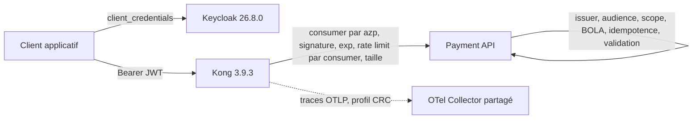
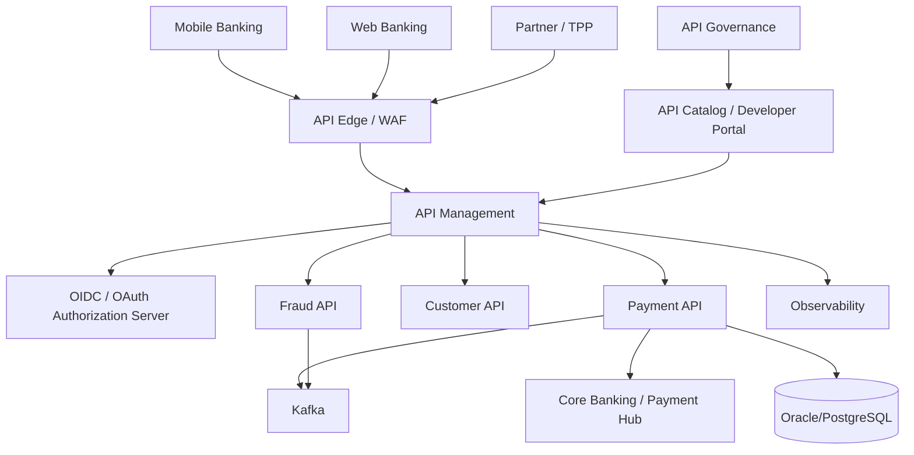

# MayaBank — API Management Solution Architecture

Référentiel d'architecture **API Management banque/assurance** avec une chaîne runtime réellement exécutée : **Keycloak → Kong → Payment API**, en CI et sur OpenShift Local (CRC).

Positionnement visé : **Architecte Solution — API Management / Integration / Security — OpenShift / Kafka / Cloud**. L'architecture est vendor-neutral (Apigee, Kong, MuleSoft, Axway…). Kong et Keycloak servent d'implémentation de référence locale.

## En deux minutes

**Prouvé** (exécuté, versions et preuves enregistrées)

| Capacité | Niveau | Preuve |
|---|---|---|
| OAuth2 `client_credentials`, audience, scopes, rejets 401/403 | CI_RUNTIME_PROVEN_E2E | [preuve CI](evidence/ci/API-MANAGEMENT-E2E-2026-10-02.md) |
| Rate limit (429), taille de payload (413), correlation-ID, idempotence | CI_RUNTIME_PROVEN_E2E | [preuve CI](evidence/ci/API-MANAGEMENT-E2E-2026-10-02.md) |
| BOLA, idempotence par client et par payload, validation IBAN, consumer Kong par client, isolation du rate limit | CI_RUNTIME_PROVEN_E2E | [preuve CI](evidence/ci/API-MANAGEMENT-E2E-2026-11-02.md) |
| Consommation OIDC et OTel partagés sur OpenShift Local 4.22.7 | CRC_RUNTIME_PROVEN | [preuve CRC](evidence/crc/API-MANAGEMENT-SHARED-PLATFORM-CRC-2026-10-02.md) |
| Contrats OpenAPI 3.2.0 / AsyncAPI 3.1.0 lintés, réponses validées contre le contrat | SPEC_LINTED / UNIT_TESTED | [validate-contracts](.github/workflows/validate-contracts.yml) |

**En cours** : performance et disponibilité mesurées (PSD3/PSR), FAPI 2.0, API comme produit (catalogue, plans), Kafka. Voir la [feuille de route](00-roadmap/evolution-2026-2027.md).

**Non revendiqué** : haute disponibilité, production readiness, certification FAPI, conformité DSP2/PSD3, Kafka en runtime.

La [Claim / Evidence Matrix](evidence/CLAIM-EVIDENCE-MATRIX.md) est la source de vérité.

## Où regarder en premier

1. [HLD](architecture/HLD.md) puis [LLD](architecture/LLD.md) : responsabilités, frontières de confiance, et répartition des contrôles entre la gateway et l'API (LLD §7)
2. [OWASP API Top 10 : mapping et contrôles implémentés](security/OWASP-API-Security-Top10-2023.md)
3. [Contrat OpenAPI](apis/openapi/payment-api.yaml) et [contrat AsyncAPI](apis/asyncapi/payment-events.yaml)
4. [Chaîne E2E](runtime/e2e/README.md) : scripts, tests nominaux et négatifs
5. [ADR](14-architecture-decisions/README.md), dont [ADR-011 : consommer la plateforme partagée](14-architecture-decisions/ADR-011-shared-platform-consumption.md)

## Chaîne runtime prouvée



| Contrôle | Gateway | API |
|---|---|---|
| Client applicatif enregistré | ✔ | |
| Signature, expiration | ✔ | ✔ |
| Audience, scope | | ✔ (non supporté par le plugin `jwt` de Kong OSS) |
| Propriété de l'objet (BOLA) | | ✔ |
| Idempotence par client et par payload | | ✔ |
| Rate limit par consumer, taille de payload | ✔ | |

## Architecture cible



## Exécuter

```bash
make contracts   # structure + lint Redocly/AsyncAPI + tests unitaires et de contrat
# chaîne Kong + Keycloak + Payment API : voir runtime/e2e/README.md
```

## Standards de référence — baseline 2026

- OpenAPI **3.2.0**, AsyncAPI **3.1.0**
- OAuth 2.0 + **RFC 9700**, OpenID Connect, PKCE
- mTLS / sender-constrained tokens selon le risque, **FAPI 2.0** pour la haute sécurité
- **OWASP API Security Top 10 — 2023** comme base de revue
- RFC 9457 (Problem Details) pour les erreurs
- OAuth 2.1 suivi comme Internet-Draft

## Parcours de connaissances

[Roadmap](00-roadmap/README.md) · [Fondations](01-foundations/README.md) · [API Design](02-api-design/README.md) · [Lifecycle](03-api-lifecycle/README.md) · [Sécurité](04-api-security/README.md) · [Gateway](05-api-gateway/README.md) · [Plateformes](06-platforms/README.md) · [Gouvernance](07-governance/README.md) · [Observabilité](08-observability/README.md) · [Résilience](09-resilience-performance/README.md) · [Event-driven](10-event-driven/README.md) · [OpenShift](11-openshift/README.md) · [Banque](12-banking/README.md) · [Intégration](13-enterprise-integration/README.md) · [ADR](14-architecture-decisions/README.md) · [POC](15-mayabank-poc/README.md) · [Entretien](16-interview-preparation/README.md) · [Labs](labs/README.md) ([statut](00-roadmap/lab-status.md))

## Positionnement honnête

Ce dépôt démontre une capacité de conception (HLD/LLD, contrats, UML, sécurité API, ADR, gouvernance) et une chaîne runtime bornée, testée avec des cas nominaux et négatifs. Il ne remplace pas une expérience de production sur Apigee, Kong, MuleSoft ou Axway. Il ne revendique ni la haute disponibilité ni la production readiness.

Le métier paiement (PSU, AISP, PISP, consentement…) est maintenu dans le [référentiel métier des paiements](https://github.com/zdmooc/banking-payments-business-architecture).
